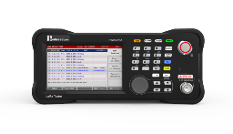
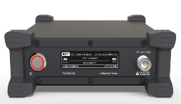
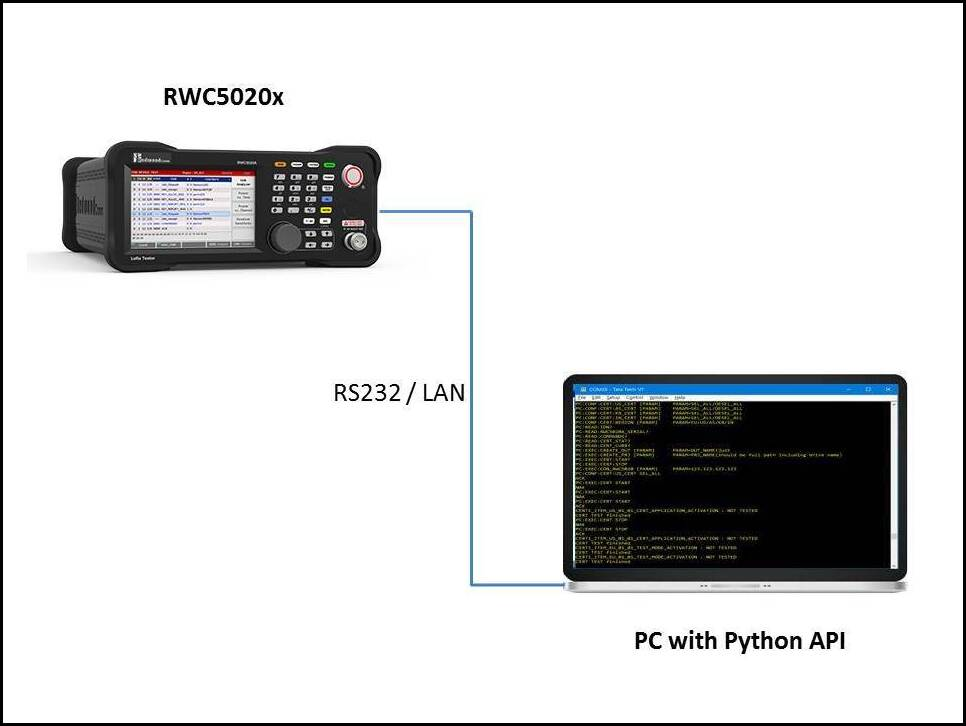

# rwc-python-api

This is a Python library to control the RWC5020x LoRa Tester remotely through either the serial port
(RS232) or the Ethernet port.

- **Supported analyzers (current generation):**

  | RWC5020B | RWC5020M |
  | :---: | :---: |
  | [](https://mcci.com/lorawan/products/rwc5020b/ "Link to RWC5020B page") | [](https://mcci.com/lorawan/products/rwc5020m/ "Link to RWC5020M page") |

- **Supported analyzer (previous generation):**

  | RWC5020A |
  | :---: |
  | [](https://mcci.com/lorawan/products/rwc5020b/ "Link to RWC5020A page") |

## Requirements

- [Python3.*](https://www.python.org/downloads/)
- [PySerial](https://pypi.org/project/pyserial/)

## API Setup



- To access RWC5020x tester using Python Library, please follow the setup shown in the diagram.

## How to install the package

1.  Clone the repository from [github](https://github.com/mcci-catena/rwc-python-api)
2.  Open a terminal window and change directory to `{path_to_repository}/rwc-python-api`.
3.  To install the library in your local Python setup, enter the command

    ```bash
    python setup.py install
    ```

## How to use the package

Create a Python file and import the class library from package:

```python
from rwclib.cRWC5020x import RWCTesterApi
```

Create a class object and pass serial port or ethernet port & ip address as constructor parameter

```python
# ---Serial Communication---
rwc = RWCTesterApi('COM5') #windows
(or)
rwc = RWCTesterApi('/dev/ttyUSB0') #Linux

# ---Ethernet Communication---
rwc = RWCTesterApi('5001', '192.168.0.33')
```

Access the class methods using instantiated object

```python
rwc.query_identification()
```

To know more about class methods, please see the **code documentation** in the following location in this repository: [`./doc/build/html/index.html`](doc/build/html/index.html)

Example scripts showing how to use the library can be found in the [`examples`](./examples) directory.

## Support

The Python library supports RWC5020x firmware from v1.150 on. v1.0.5 to v1.1.0 were tested with an RWC5020B running firmware v1.500.

The library logs each command and response through Python's `logging` module, under the logger `rwclib.cRWCSerialSetup`. To see them, configure logging in your script, for example `logging.basicConfig(level=logging.INFO)`.

## Release History

- v1.1.0 has the following changes:
  - Part of [#18](https://github.com/mcci-catena/rwc-python-api/issues/18): methods for commands in the v1.500 manual that the library lacked: EDT channel plan, RX AGC, NST implicit header, coding rate and payload size, NST frame-count averaging, FOpts user payload and its size, uplink and downlink dwell time, general application key, sensitivity PER result by index, and the 64-channel and AU, RU, IL and EU433 certification option queries.
  - On firmware v1.500, `link_getfoptspayload()` gets NAK even after `link_setfoptspayload()` has set a payload. The dwell-time getters return `1` for 400ms and `0` for NO_LIMIT.

- v1.0.9 has the following changes:
  - Part of [#18](https://github.com/mcci-catena/rwc-python-api/issues/18): `sensitivity_setrx2frequency()` works (it was a stub); uplink and downlink channel methods take an optional channel number; firmware version checks use numeric ranges instead of lists, and fail with a clear error if the tester doesn't report its version.

- v1.0.8 has the following changes:
  - Part of [#18](https://github.com/mcci-catena/rwc-python-api/issues/18): region names AU_915, KR_920 and IN_865 (old names still accepted); ICA operator; ranges for target PER, power Y-axis minimum, fragment padding, MFG packet interval and TX power; payload setters take bytes or hex strings starting with `0x`, and keep leading zero bytes; per-channel power for channels above 7.
  - Payload and sync-word setters read a plain string as decimal, as v1.0.4 did. v1.0.5 to v1.0.7 read a plain string passed to `nst_tx_setpayload()` or a sync-word setter as hex; write hex as `'0x...'` or pass bytes.

- v1.0.7 has the following changes:
  - Part of [#18](https://github.com/mcci-catena/rwc-python-api/issues/18): `link_getmacsendresult()` sends `MAC_SEND_RESULT`; `link_set/getadrchmask_optdr()` send `ADR_CH_MASK_OPT <MAC_NUM>` on firmware v1.200 and later; `nst_rx_settxpolarity()` sends `RX_POLARITY`; `nst_tx_getmode()` reads `MODULATION`. Methods for commands deleted in firmware v1.32 and v1.33 raise on that firmware and later.
  - Offline tests in `tests/test_commands.py`.

- v1.0.6 has the following changes:
  - All six RF frequency setters send the frequency to 1 Hz. v1.0.5 kept only 6 significant digits in `rf_setfrequency()` and `rf_settxfrequency()` (865.0625 MHz went out as 865.062), and the other four truncated to whole MHz.
  - Over Ethernet, `transceive()` discards replies that arrive after a timeout, so they no longer shift every later reply by one. The timeout is 15 s; `CONF:RF:RX_FREQ` takes about 5.5 s.

- v1.0.5 has the following changes:
  - Fix [#14](https://github.com/mcci-catena/rwc-python-api/issues/14): commands that failed on firmware v1.500. Data-rate setters accept any firmware from v1.170 on; frequency setters accept fractional MHz; `nst_tx_setpayloadsize()` sends the NST command; `nst_tx_setpayload()` and the sync-word setters take bytes or hex strings; NST getters use `READ:` queries.
  - Fix [#13](https://github.com/mcci-catena/rwc-python-api/issues/13): the library no longer configures logging or writes `../logs/rwcapi.log`; `setup.py` requires pyserial.

- v1.0.4 has the following changes:
  - Fix [#6](https://github.com/mcci-catena/rwc-python-api/issues/6): Added new remote commands for the latest firmware v1.310

- v1.0.3.10 includes the following changes:
  - Fix [#2](https://github.com/mcci-catena/rwc-python-api/issues/2): Updated latest remote commands and added backward compatibility to python library for support of RWC5020x firmware from v1.150 to v1.305.
